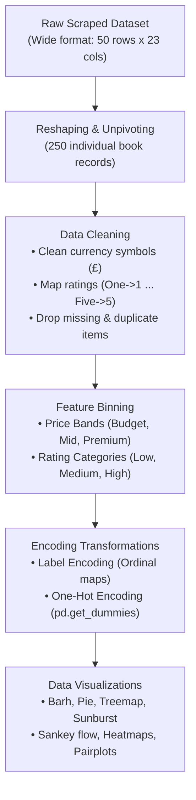

# Assignment 2: Feature Engineering & Data Visualization

**Course:** Artificial Intelligence & Machine Learning  
**Author:** Shruti Siddheshwar Thorat  
**PRN:** 202401040053  
**Roll No:** 16  

---

## 📌 Project Overview

This project implements an end-to-end data pipeline:
1. **Web Scraping & Collection:** Collected raw book catalog records from `books.toscrape.com`.
2. **Reshaping:** Normalized multi-column wide-format data into clean granular book records.
3. **Data Cleaning & Normalization:** Stripped currency signs (£), mapped word-based ratings to numeric values, handled missing observations, and eliminated duplicate entries.
4. **Feature Engineering & Encoding:** Engineered domain-specific price and rating bins, performed ordinal/label encoding, and applied one-hot encoding for downstream machine learning readiness.
5. **Multi-Faceted Data Visualization:** Evaluated distributions, hierarchies, and category flows using Matplotlib, Seaborn, and Plotly.

---

## 🛠️ Data Pipeline Architecture



---

## 🔬 Feature Engineering Details

### 1. Data Cleaning & Type Casting
- **Price:** Stripped currency symbol `£` using `.str.replace('£', '', regex=False)` and cast to `float64`.
- **Rating:** Converted textual representations to integers:
  $$\text{rating} \in \{\text{'One'}: 1, \text{'Two'}: 2, \text{'Three'}: 3, \text{'Four'}: 4, \text{'Five'}: 5\}$$
- **Availability:** Extracted in-stock boolean flags ($1$ for In stock, $0$ for Out of stock).

### 2. Feature Binning
- **`price_band`**:
  - `Budget`: $[0, 20]$
  - `Mid`: $(20, 40]$
  - `Premium`: $(40, \infty)$
- **`rating_category`**:
  - `Low`: $[0, 2]$
  - `Medium`: $(2, 3]$
  - `High`: $(3, 5]$

### 3. Encoding Strategies
- **Label Encoding:** Integer encoding for ordinal hierarchies:
  - `price_enc`: Budget ($1$), Mid ($2$), Premium ($3$)
  - `rating_category_enc`: Low ($1$), Medium ($2$), High ($3$)
  - `availability_enc`: Out of stock ($0$), In stock ($1$)
- **One-Hot Encoding:** Binary dummy indicators generated using `pd.get_dummies`:
  - `price_Budget`, `price_Mid`, `price_Premium`
  - `rating_Low`, `rating_Medium`, `rating_High`

---

## 📊 Visualizations Included

1. **Horizontal Bar Chart:** Quantity of books across price bands.
2. **Pie Chart:** Percentage breakdown across star ratings (1 to 5 stars).
3. **Plotly Treemap:** Hierarchical representation of book distribution by price and rating.
4. **Stacked Bar Chart:** Rating composition within each price tier.
5. **Plotly Sunburst:** Nested circular visualization showing the distribution tree.
6. **Plotly Sankey Diagram:** Directional volume flow between price tiers and rating brackets.
7. **Cross-tab Heatmap:** Frequency matrix comparing rating tiers against price tiers.
8. **Pairplot:** Bivariate relationships and histograms across encoded variables.
9. **Correlation Matrix:** Inter-category correlation across one-hot features.

---

## 💻 How to Run

### Option 1: Jupyter / Google Colab
Open `Assignment_2_Feature_Engineering.ipynb` in Google Colab or Jupyter Notebook and run all cells sequentially.

### Option 2: Python Script
Ensure dependencies are installed:
```bash
pip install pandas numpy matplotlib seaborn plotly
```
Execute the script:
```bash
python feature_engineering.py
```
*(Optionally pass a custom CSV dataset as an argument)*:
```bash
python feature_engineering.py path/to/dataset.csv
```
